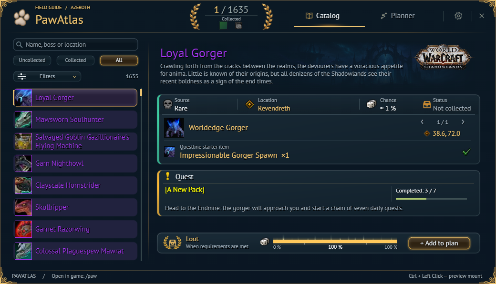
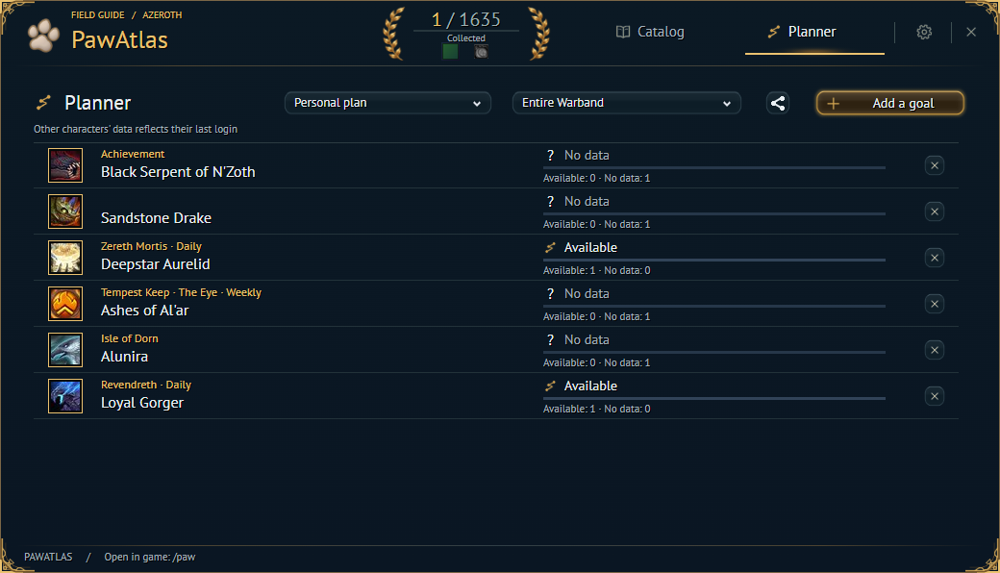
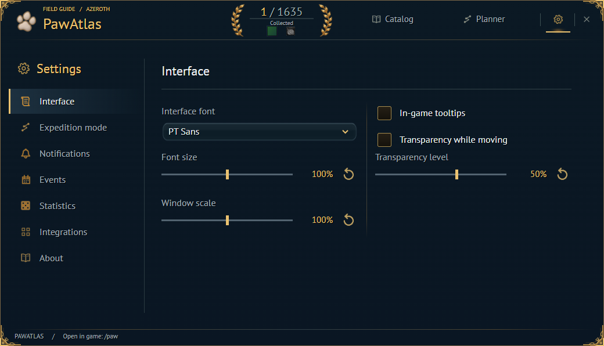

<h1 align="center">PawAtlas</h1>

<a href="README.md">Русский</a> · <b>English</b>

Your mount collection guide and farming planner for WoW Retail (12.1.5).

<a href="https://github.com/Zik/PawAtlas/releases/latest">📦 Download from GitHub</a> · <a href="https://www.curseforge.com/wow/addons/pawatlas">CurseForge</a> · <a href="https://github.com/Zik/PawAtlas/issues">🐛 Report an issue</a>

## 🐾 Your mount-hunting companion

- 🔎 **Catalog** — search by mount, boss, or location. Filter by expansion or any of ten acquisition methods.
- 🗺️ **Mount cards** — switch routes and cycle through waypoints. See vendor prices and requirements, or check quest and achievement progress.
- 🎲 **Attempts & chances** — see drop chances, count attempts, and track items as you collect them. Import your farming history from Rarity.
- 📋 **Warband planner** — create goal lists, check each character’s lockouts, and share plans with friends.
- 🧭 **Expedition mode** — follow your goals in a compact tracker and set waypoints with WoW or TomTom.
- 🤝 **Collection sharing** — a chat link opens your mounts in the catalog with search and filters.
- 🔔 **Settings** — loot notifications, event reminders, fonts, tooltips, and window scale.

## 📸 Take a look

📸 Warband planner and settings

*Screenshots use demo data.*

## 📦 Installation

1. Download **PawAtlas-X.Y.Z.zip** from the [latest release](https://github.com/Zik/PawAtlas/releases/latest).
2. Extract the **PawAtlas** folder into `World of Warcraft/_retail_/Interface/AddOns/`.
3. Enable the addon and type **/paw**, or click the minimap paw.

## 🖱️ Quick controls

| Action | Where |
| --- | --- |
| Open the atlas | `/paw`, `/pawatlas`, or PawAtlas in the minimap addon menu |
| Import Rarity attempts | Settings → Integrations |
| Enable the tracker | Settings → Expedition mode |
| Choose holiday and world boss reminders | Settings → Events. Hover over an event to see its mounts |
| Share a plan or import one from a code | Share icon in the planner |
| Share your collection | Open chat (including WIM whispers), then Shift + left-click the collection count |
| Use the broker counter | Left-click: target · Right-click: atlas · Shift + left-click: tracker |

> 💡 To view a shared collection, both players must be online with PawAtlas. Each character’s lockouts update when you log in on that character. The cumulative drop chance is an estimate.

🤝 Credits & resources

Thanks to the authors of the projects whose data, libraries, and tools helped make PawAtlas:

- [Rarity: Collector’s Edition](https://github.com/aSnejbjerg/Rarity-Collectors-edition) — source data, drop chances, and tracking conditions.
- [WoWthing](https://github.com/ThingEngineering/wowthing-data) and [Simple Armory](https://github.com/kevinclement/SimpleArmory) — catalog and expansion data.
- [LiteMount](https://github.com/xod-wow/LiteMount) — mount expansion metadata.
- [TrinityCore](https://github.com/TrinityCore/TrinityCore) and [Wowhead](https://www.wowhead.com/npcs) — creature display data for NPC portraits.
- [All The Things](https://github.com/ATTWoWAddon/AllTheThings), [HandyNotes](https://github.com/kemayo) and [HandyNotes: The War Within](https://github.com/zarillion/handynotes-plugins) — sources and coordinates.
- [TomTom](https://www.curseforge.com/wow/addons/tomtom/source) — navigation arrow integration.
- [Ace3](https://github.com/WoWUIDev/Ace3), [LibDataBroker](https://github.com/tekkub/libdatabroker-1-1), [LibStub](https://repos.wowace.com/wow/libstub/trunk/), [CallbackHandler](https://repos.wowace.com/wow/callbackhandler/trunk/), [LibSharedMedia](https://repos.wowace.com/wow/libsharedmedia-3-0/trunk/) — bundled libraries.

---

🐾 Happy mount hunting!

