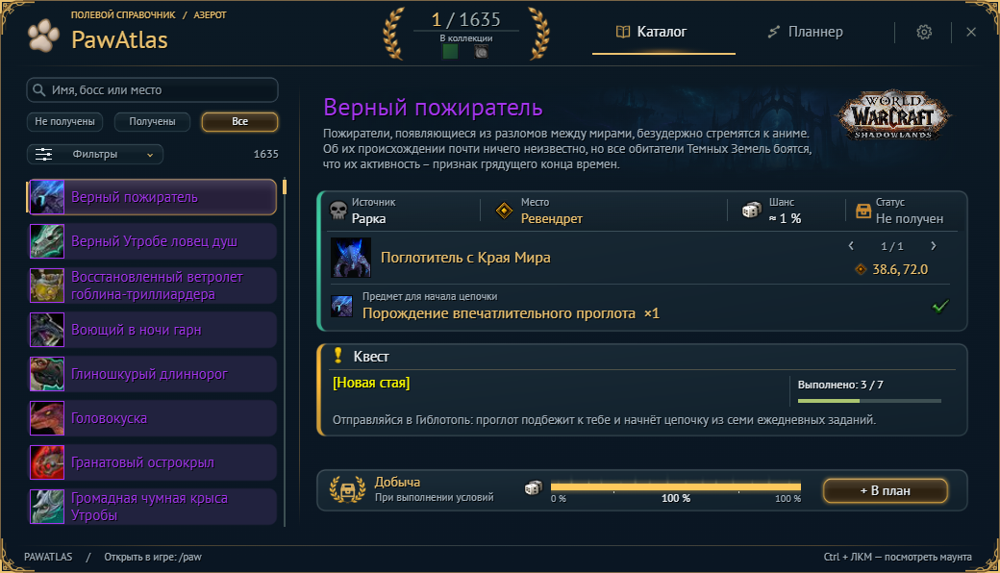
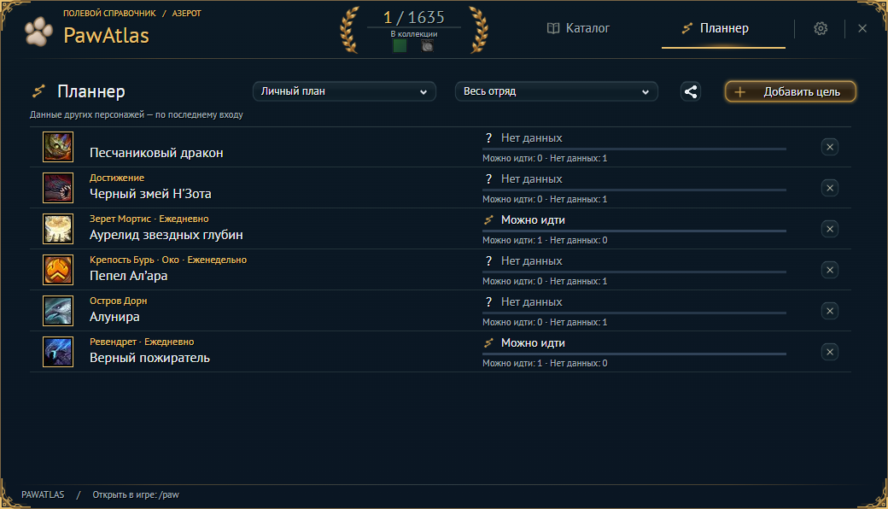
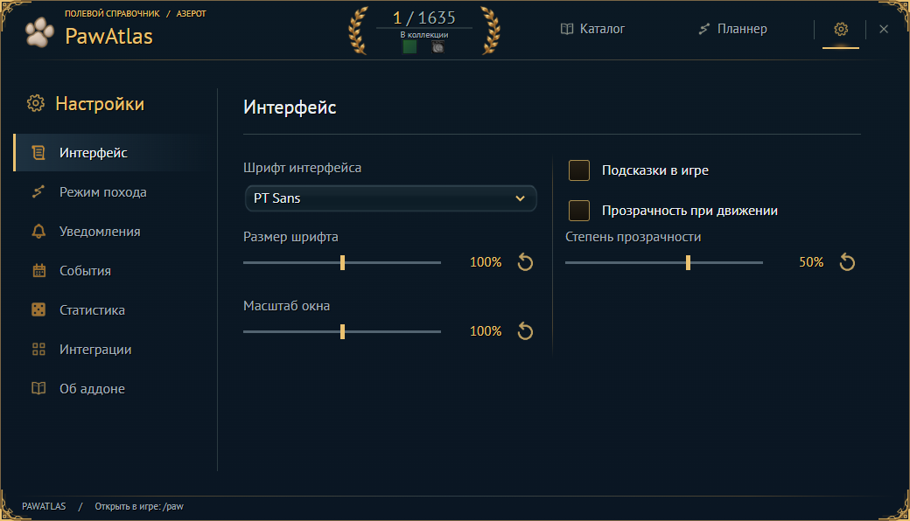

<h1 align="center">PawAtlas</h1>

<b>Русский</b> · <a href="README.en.md">English</a>

Твой справочник и планнер охоты за маунтами в WoW Retail (12.1.5).

<a href="https://github.com/Zik/PawAtlas/releases/latest">📦 Скачать с GitHub</a> · <a href="https://www.curseforge.com/wow/addons/pawatlas">CurseForge</a> · <a href="https://github.com/Zik/PawAtlas/issues">🐛 Сообщить об ошибке</a>

## 🐾 Всё для охоты за маунтами

- 🔎 **Каталог** — поиск по имени, боссу или месту, фильтры по дополнениям и десяти способам получения. Сортируй по имени, наличию в коллекции, шансу выпадения за одну попытку или вероятности за все учтённые попытки.
- 🗺️ **Карточка маунта** — переключай маршруты и точки на карте, проверяй цены и требования торговцев, отслеживай прогресс заданий и достижений. У рарок с известным интервалом появления есть часы с подсказкой.
- 🎲 **Попытки и шансы** — счётчик попыток, шанс выпадения, прогресс сбора предметов и импорт истории из Rarity. Shift + ЛКМ по счётчику вставляет ссылку и число попыток в открытую строку чата. Нажми Enter, чтобы отправить.
- 📋 **Планнер отряда** — создавай списки целей, проверяй сохранения персонажей и обменивайся планами с друзьями.
- 🧭 **Режим похода** — следи за целями в отдельном окне и ставь метки WoW или TomTom. Такой же список открывается из нижнего бара. Потяни за уголок, чтобы изменить размер. Размер, закрепление и прозрачность общие для обоих окон.
- 🤝 **Сравнение коллекций** — открой ссылку игрока в чате и посмотри, какие из его маунтов у тебя уже есть, а какие ещё можно собрать.
- 🔔 **Настройки** — уведомления о добыче, напоминания о событиях, шрифты, подсказки и масштаб окна.

## 📸 Как выглядит

📸 Планнер отряда и настройки

*На скриншотах показаны демонстрационные данные.*

## 📦 Установка

1. Скачай **PawAtlas-X.Y.Z.zip** из [последнего релиза](https://github.com/Zik/PawAtlas/releases/latest).
2. Распакуй папку **PawAtlas** в `World of Warcraft/_retail_/Interface/AddOns/`.
3. Включи аддон и введи **/paw** — или нажми на лапку у миникарты.

## 🖱️ Под рукой

| Что сделать | Как |
| --- | --- |
| Открыть атлас | `/paw`, `/pawatlas` или PawAtlas в меню аддонов у миникарты |
| Импортировать попытки Rarity и посмотреть, какие счётчики изменились | Настройки → Интеграции → Импорт из Rarity → Сводка |
| Включить окно слежения | Настройки → Режим похода |
| Скрыть или вернуть персонажа в планнере отряда | Настройки → Статистика → значок глаза в строке персонажа |
| Настроить напоминания о праздниках и мировых боссах | Настройки → События. Наведи на событие, чтобы увидеть связанных маунтов |
| Переименовать созданный или импортированный план | Выбери его в планнере, открой список планов и нажми «Переименовать» |
| Изменить порядок планов | Перетащи план вверх или вниз в списке. «Личный план» всегда первый |
| Поделиться планом или импортировать его по коду | Значок «Поделиться» в планнере |
| Поделиться коллекцией | Открой чат (включая личку WIM) и нажми Shift + ЛКМ по числу у венков |
| Управлять счётчиком в баре | ЛКМ — цель · ПКМ — атлас · Shift + ЛКМ — слежение |

> 💡 Для просмотра чужой коллекции оба игрока должны быть онлайн с PawAtlas. Сохранения персонажа обновляются при входе в игру за него. Вероятность за несколько попыток — оценка.

🤝 Благодарности и ресурсы

Спасибо авторам проектов, чьи данные, библиотеки и инструменты помогли PawAtlas:

- [Rarity: Collector’s Edition](https://github.com/aSnejbjerg/Rarity-Collectors-edition) — данные источников, шансов и условий учёта.
- [WoWthing](https://github.com/ThingEngineering/wowthing-data) и [Simple Armory](https://github.com/kevinclement/SimpleArmory) — данные каталога и дополнений.
- [LiteMount](https://github.com/xod-wow/LiteMount) — данные дополнения первого выпуска маунтов.
- [TrinityCore](https://github.com/TrinityCore/TrinityCore) и [Wowhead](https://www.wowhead.com/npcs) — данные об обликах NPC для портретов.
- [All The Things](https://github.com/ATTWoWAddon/AllTheThings), [HandyNotes](https://github.com/kemayo) и [HandyNotes: The War Within](https://github.com/zarillion/handynotes-plugins) — источники и координаты.
- [TomTom](https://www.curseforge.com/wow/addons/tomtom/source) — интеграция с навигационной стрелкой.
- [Ace3](https://github.com/WoWUIDev/Ace3), [LibDataBroker](https://github.com/tekkub/libdatabroker-1-1), [LibStub](https://repos.wowace.com/wow/libstub/trunk/), [CallbackHandler](https://repos.wowace.com/wow/callbackhandler/trunk/), [LibSharedMedia](https://repos.wowace.com/wow/libsharedmedia-3-0/trunk/) — встроенные библиотеки.

---

🐾 Удачной охоты за маунтами!

