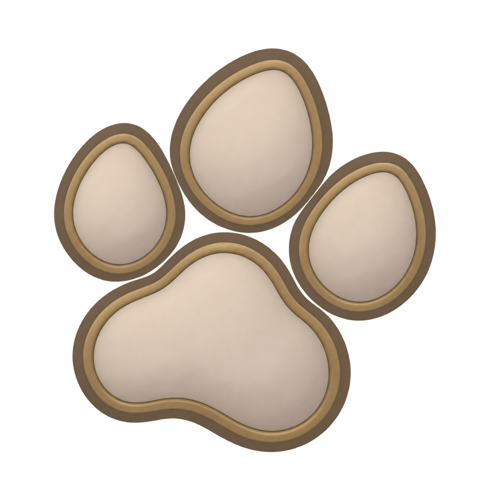
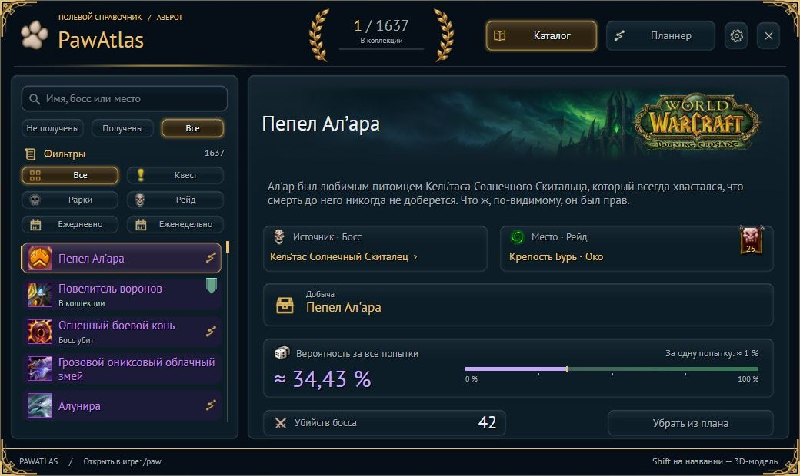
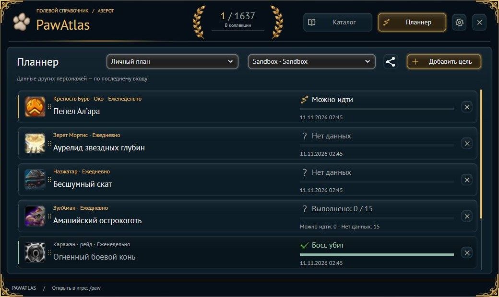

<h1 align="center">PawAtlas</h1>

<b>Русский</b> · <a href="README.en.md">English</a>

Твой справочник и планнер охоты за маунтами в WoW Retail (12.1.5).

<a href="https://github.com/Zik/PawAtlas/releases/latest">📦 Скачать аддон</a> · <a href="https://github.com/Zik/PawAtlas/issues">🐛 Сообщить об ошибке</a>

## 🐾 Всё для охоты за маунтами

- 🔎 **Каталог** — поиск, источники получения и подборки по дополнениям.
- 🎲 **Попытки и шансы** — история фарма, сбор предметов и импорт из Rarity.
- 📋 **Твои планы** — отдельные списки целей, импорт и обмен с друзьями.
- 🧭 **Режим похода** — компактное окно целей и навигация к источникам.
- 🤝 **Обмен коллекцией** — ссылка в чате открывает твоих маунтов в каталоге с поиском и фильтрами.
- 🔔 **Настройки под тебя** — уведомления, шрифты, подсказки и счётчик на панелях.

## 📸 Как выглядит

📸 Ещё скриншоты — планнер отряда

*Актуальный интерфейс в превью, демонстрационные данные.*

## 📦 Установка

1. Скачай **PawAtlas-X.Y.Z.zip** из [последнего релиза](https://github.com/Zik/PawAtlas/releases/latest).
2. Распакуй папку **PawAtlas** в `World of Warcraft/_retail_/Interface/AddOns/`.
3. Включи аддон и введи **/paw** — или нажми на лапку у миникарты.

## 🖱️ Под рукой

| Что сделать | Как |
| --- | --- |
| Открыть атлас | `/paw` или `/pawatlas` |
| Импортировать попытки Rarity | Настройки → Интеграции |
| Включить окно слежения | Настройки → Интерфейс → Режим похода |
| Поделиться планом | Значок «Поделиться» в планнере |
| Поделиться коллекцией | Открой чат (включая личку WIM) и нажми Shift + ЛКМ по числу у венков |
| Управлять счётчиком в баре | ЛКМ — цель · ПКМ — атлас · Shift + ЛКМ — слежение |

> 💡 Для просмотра общей коллекции оба игрока должны быть онлайн с PawAtlas. Данные других персонажей обновляются при входе на них. Проценты — оценка, а не гарантия выпадения.

🤝 Благодарности и ресурсы

Спасибо авторам проектов, чьи данные, библиотеки и инструменты помогли PawAtlas:

- [Rarity: Collector’s Edition](https://github.com/aSnejbjerg/Rarity-Collectors-edition) — данные источников, шансов и условий учёта.
- [WoWthing](https://github.com/ThingEngineering/wowthing-data) и [Simple Armory](https://github.com/kevinclement/SimpleArmory) — данные каталога и дополнений.
- [LiteMount](https://github.com/xod-wow/LiteMount) — данные дополнения первого выпуска маунтов.
- [HandyNotes](https://github.com/kemayo) — координаты источников.
- [TomTom](https://www.curseforge.com/wow/addons/tomtom/source) — интеграция с навигационной стрелкой.
- [Ace3](https://github.com/WoWUIDev/Ace3), [LibDataBroker](https://github.com/tekkub/libdatabroker-1-1), [LibStub](https://repos.wowace.com/wow/libstub/trunk/), [CallbackHandler](https://repos.wowace.com/wow/callbackhandler/trunk/), [LibSharedMedia](https://repos.wowace.com/wow/libsharedmedia-3-0/trunk/) — встроенные библиотеки.

---

🐾 Удачной охоты за маунтами!

